# ts-models

个股崩盘预测的时序深度学习基线库。核心任务：用过去 60 个交易日的技术面特征（周五采样），预测两类崩盘事件，是典型的**极端不平衡时序二分类**问题。

研究设计的完整决策（双标签公式、参数、验证协议）见 `docs/RESEARCH_DESIGN.md`（唯一设计事实来源）。

当前实现五代 LSTM 管线：**gen1 单股冒烟**、**gen2 小池验证**（40 只）、**gen3 扩展面板**（662 只）、**gen4 数据扩展与新协议**与 **gen5 中证800 并集**（1577 只）。数据源为 BaoStock（A股，无需注册）与 yfinance（美股）。

## 目录结构

```
ts-models/
├── src/tsmodels/            # 核心库
│   ├── data.py              # 双数据源下载与缓存（BaoStock / yfinance → data/*.csv）
│   ├── features.py          # 21 维技术面特征（因果计算，仅用 t 及以前信息）
│   ├── labels.py            # 双标签：标准A 日频极值 + 标准B 市场模型崩盘周
│   ├── dataset.py           # 周采样滑窗 Dataset（60 交易日 × 21 维）
│   ├── models.py            # LSTM / GRU / TCN 基线模型
│   ├── panel.py             # 面板缓存载入、标准化、滑窗、时间切分、预测分数落盘
│   ├── plotstyle.py         # 绘图统一样式（中文宋体 + Times New Roman 10.5pt）
│   └── train.py             # winsorize + 标准化、训练循环、分类指标
├── scripts/
│   ├── run_weekly_baseline.py   # 单股冒烟验证（gen1）：双标签训练与评估
│   ├── run_panel_baseline.py    # 面板训练（gen2–gen5）：LSTM/GRU/TCN，含 --eval-only 推理
│   ├── run_classic_baseline.py  # 传统基线（LightGBM / 逻辑回归），复用面板缓存
│   └── make_figures.py          # 生成 docs/figures/ 全部图表（PNG 300dpi + SVG）
├── docs/
│   ├── RESEARCH_DESIGN.md   # 研究设计决策底稿（标签公式、参数、协议）
│   └── figures/             # 图表产物（结果图 + 结构图）
├── data/                    # 数据快照 dataset1/2/3（不入库）
└── outputs/                 # 产物（不入库，结构见下文）
```

## 环境准备

```powershell
python -m venv .venv
.venv\Scripts\Activate.ps1
pip install -r requirements.txt
```

## 运行

```powershell
python scripts\run_weekly_baseline.py
```

默认：`sz.300750`（宁德时代），市场指数 `sh.000300`（沪深300），2015-01-01 至 2026-01-01，输入回看 60 个交易日。一次运行同时训练**标准 A / 标准 B 两个标签**的 LSTM。

常用参数：

```powershell
python scripts\run_weekly_baseline.py --ticker sz.000001              # 换标的（平安银行）
python scripts\run_weekly_baseline.py --ticker sz.300750 --pos-weight # 正类加权对照
python scripts\run_weekly_baseline.py --ticker sz.300750 --refresh    # 强制重新下载数据
python scripts\run_weekly_baseline.py --ticker sz.300750 --sigma 3.09 # 崩盘周阈值敏感性
```

> 注：Yahoo 对部分网络环境限流（403/429），此时使用 BaoStock 源的 A 股代码；缓存文件存在且列齐全时不会重新下载，换日期范围需加 `--refresh`。

面板正式训练（gen2 小池 → gen5 千级递进）：

```powershell
python scripts\run_panel_baseline.py --only-fetch   # 抓取股票池数据（支持断点续抓，可重复运行至完成）
python scripts\run_panel_baseline.py                # gen2：默认 40 只沪深300成分均匀抽样
python scripts\run_panel_baseline.py --pos-weight   # 加权配置

python scripts\run_panel_baseline.py --pool-file _local/astock-pool-union.txt --data-dir data/dataset2 --gen gen4 --start 2013-01-01 --end 2026-10-10 --train-start 2017-01-01 --split-date 2025-01-01 --epochs 10 --batch-size 128
```

> `--tickers "sh.600519,sz.000858"` 可指定股票池；`--pool-file` 读取清单文件（本地素材放 `_local/`，不入库）；`--data-dir` 指定数据快照目录；`--train-start` / `--split-date` 显式指定训练起点与测试段起点。面板构建结果自动缓存（`panel_cache/`），参数或股票池变化时自动重建，`--rebuild-cache` 强制重建。

对照模型、推理评估与出图：

```powershell
python scripts\run_panel_baseline.py --pool-file _local/astock-pool-union-800.txt --data-dir data/dataset3 --gen gen5 --model gru --start 2013-01-01 --end 2026-10-10 --train-start 2017-01-01 --split-date 2025-01-01 --epochs 10 --batch-size 128
python scripts\run_panel_baseline.py ... --model tcn            # 同理可换 tcn
python scripts\run_panel_baseline.py ... --epochs 10 --batch-size 128 --eval-only   # 仅载入已保存权重复算指标并导出预测分数
python scripts\run_classic_baseline.py --panel-dir outputs/models/lstm/gen5 --model lgbm --gen gen5 --split-date 2025-01-01 --train-start 2017-01-01
python scripts\run_classic_baseline.py --panel-dir outputs/models/lstm/gen5 --model logreg --gen gen5 --split-date 2025-01-01 --train-start 2017-01-01
python scripts\make_figures.py                                  # 生成 docs/figures/ 图表
```

> `--labels labelA5d` 可只跑单个标签（断点续跑）；`--pos-weight` 为召回优先的加权配置。面板训练同时导出 `scores_*.npz`（测试集预测分数），供 ROC/PR/校准等曲线复算。

## 输出结构

产物按 **`outputs/models/<模型类型>/<代际>/`** 两级子目录存放：

```
outputs/models/lstm/gen1/               # 单股冒烟（每标的独立模型）
├── lstm_labelA5d_sz.300750.pt          # 模型权重（_pw 后缀为加权损失变体）
├── metrics_labelA5d_sz.300750.json     # 参数、loss 历史、测试指标
├── diagnostics_flags_sz.300750.json    # 崩盘周分年统计
└── prep_sz.300750.json                 # winsorize 边界 + 标准化参数

outputs/models/lstm/gen2/               # 小池面板（全池一个模型）
├── lstm_labelA5d_panel.pt              # 面板模型（_pw 为加权变体）
├── metrics_labelA5d_panel.json         # 含分年指标拆解
├── panel_samples.csv                   # 面板样本表（date/ticker/双标签，13,637 行）
├── panel_stats.json                    # 逐标的样本数与崩盘周统计
└── prep_panel.json                     # 池化 winsorize + 标准化参数

outputs/models/lstm/gen3/               # 扩展面板（662 只并集池）
├── lstm_labelA5d_panel.pt              # 面板模型（_pw 为加权变体）
├── metrics_labelA5d_panel.json         # 含分年指标拆解
├── panel_samples.csv                   # 面板样本表（235,482 行）
├── panel_stats.json                    # 644 只有效标的统计 + 18 只跳过清单
├── prep_panel.json                     # 池化 winsorize + 标准化参数
└── panel_cache/                        # 中间缓存（features.pkl + meta.json）

outputs/models/lstm/gen4/               # 数据扩展 + 新协议（662 只 / 2013 起 / test 2025-01 起）
├── lstm_labelA5d_panel.pt              # 面板模型（_pw 为加权变体）
├── metrics_labelA5d_panel.json         # 含分年指标拆解
├── panel_samples.csv                   # 面板样本表（309,677 行）
├── panel_stats.json                    # 653 只有效标的统计 + 9 只跳过清单
├── prep_panel.json                     # 池化 winsorize + 标准化参数
└── panel_cache/                        # 中间缓存

outputs/models/lstm/gen5/               # 中证800 并集（1577 只 / test 2025-01 起）
├── lstm_labelA5d_panel.pt              # 面板模型（_pw 为加权变体）
├── metrics_labelA5d_panel.json         # 含分年指标拆解
├── panel_samples.csv                   # 面板样本表（711,848 行）
├── panel_stats.json                    # 1541 只有效标的统计 + 36 只跳过清单
├── prep_panel.json                     # 池化 winsorize + 标准化参数
└── panel_cache/                        # 中间缓存
```

新模型类型（如 tcn）或新一代设计（如 gen5）时会新建对应目录，不覆盖旧代际。

## 数据快照

`data/dataset1|2|3/` 为三份股票池快照，每份含全部个股 CSV + 指数 `sh.000300.csv`：

- `dataset1/`：40 只小池（gen2 时代）
- `dataset2/`：662 只沪深300 历史并集（gen3–gen4）
- `dataset3/`：1577 只中证800 历史并集（gen5）

脚本用 `--data-dir data/datasetN` 指定快照；数据根目录已整理为快照专属结构。

## 标签定义与评估

- **标准 A**：未来 5 个交易日内单日收益（后复权）< -8%（收益率极值法，对照标签）
- **标准 B**：Dimson 市场模型剥离沪深300 后，个股特异性周收益 W ≤ 滚动 52 周均值 - 3.2σ 定义为崩盘周；标签为"未来 4 周内是否出现崩盘周"（学界标准 + 预测化改造，公式见 `docs/RESEARCH_DESIGN.md` §2）
- 评估指标：**ROC-AUC、PR-AUC、F1、Recall**；禁用 Accuracy（全猜 0 也能 95%+）

## 示例结果（seed=42）

### 中证800 并集（gen5，1577 只；测试段 2025-01 ~ 2026-08）

面板规模：711,848 周样本（1541 只有效标的）、崩盘周合计 3,672 个；train 510,467 / test 124,590。

| 标签 | 配置 | 测试 ROC-AUC | 测试 PR-AUC | Recall | F1 | 分年 ROC（2025 / 2026） |
|---|---|---|---|---|---|---|
| A5d | 普通 | 0.729 | 0.144 | 0.02 | 0.04 | 0.656 / 0.847 |
| A5d | 加权 | 0.705 | 0.105 | 0.51 | 0.17 | 0.628 / 0.837 |
| B4w | 普通 | 0.676 | 0.052 | 0.00 | 0.01 | 0.694 / 0.669 |
| B4w | 加权 | 0.657 | 0.049 | 0.46 | 0.08 | 0.698 / 0.666 |

规模从 662 → 1577 只，普通配置继续小幅提升（A5d ROC 0.709→0.729、B4w 0.650→0.676）；2026 年 labelA 加权 Recall 0.75。

### 数据扩展与新协议（gen4，662 只 / 数据 2013 起；测试段 2025-01 ~ 2026-08）

面板规模：309,677 周样本（653 只有效标的）、崩盘周合计 1,397 个；train 222,549（2017-01-06 ~ 2024-11-15）/ test 54,167。

| 标签 | 配置 | 测试 ROC-AUC | 测试 PR-AUC | Recall | F1 | 分年 ROC（2025 / 2026） |
|---|---|---|---|---|---|---|
| A5d | 普通 | 0.709 | 0.120 | 0.03 | 0.05 | 0.622 / 0.869 |
| A5d | 加权 | 0.674 | 0.093 | 0.50 | 0.14 | 0.576 / 0.857 |
| B4w | 普通 | 0.650 | 0.047 | 0.00 | 0.01 | 0.677 / 0.648 |
| B4w | 加权 | 0.647 | 0.054 | 0.47 | 0.06 | 0.690 / 0.638 |

2026 年 labelA 信号最强（加权 Recall 0.80）；测试标签止于 2026-08-28 属固定「前瞻损失」（B 标签 4 周 + Dimson 干净期 2 周 ≈ 6 周，设计内行为）。

### 扩展面板正式训练（gen3，662 只历史沪深300成分并集；测试段 2024-06 ~ 2025-11）

面板规模：235,482 周样本（644 只有效标的）、崩盘周合计 1,036 个；train 184,403 / test 47,364。

| 标签 | 配置 | 测试 ROC-AUC | 测试 PR-AUC | Recall | F1 | 分年 ROC（2024 / 2025） |
|---|---|---|---|---|---|---|
| A5d | 普通 | 0.698 | 0.103 | 0.03 | 0.06 | 0.814 / 0.612 |
| A5d | 加权 | 0.711 | 0.113 | 0.46 | 0.17 | 0.813 / 0.640 |
| B4w | 普通 | 0.671 | 0.036 | 0.00 | 0.00 | 0.615 / 0.718 |
| B4w | 加权 | 0.632 | 0.035 | 0.50 | 0.04 | 0.601 / 0.664 |

规模扩大后普通配置明显改善（A5d 0.590→0.698、B4w 0.649→0.671）；加权配置召回达 0.46–0.50。

### 小池正式训练（gen2，40 只沪深300成分；测试段 2024-07 ~ 2025-11）

面板规模：13,637 周样本（2017-11 ~ 2025-11），崩盘周合计 50 个；train 10,660 / test 2,749。

| 标签 | 配置 | 测试 ROC-AUC | 测试 PR-AUC | Recall | F1 | 分年 ROC（2024 / 2025） |
|---|---|---|---|---|---|---|
| A5d | 普通 | 0.590 | 0.108 | 0.00 | 0.00 | 0.383 / 0.738 |
| A5d | 加权 | 0.715 | 0.102 | 0.42 | 0.17 | 0.766 / 0.671 |
| B4w | 普通 | 0.649 | 0.036 | 0.00 | 0.00 | 0.726 / 0.573 |
| B4w | 加权 | 0.673 | 0.033 | 0.27 | 0.06 | 0.780 / 0.584 |

加权配置显著改善召回与判别力；分年拆解提示有效性存在时变（2024 强于 2025）。

### 单股冒烟（gen1）

| 标的 | 标签 | 测试 ROC-AUC | 测试 PR-AUC | 说明 |
|---|---|---|---|---|
| sz.300750 | A5d（普通 / 加权） | 0.0543 / 0.2065 | 0.0329 / 0.0389 | 测试段仅 2 个正样本 |
| sz.300750 | B4w（普通 / 加权） | — | — | 测试段 0 正样本 |
| sz.000001 | A5d（普通 / 加权） | 0.0247 / 0.1605 | 0.0186 / 0.0211 | 测试段仅 2 个正样本 |
| sz.000001 | B4w（普通 / 加权） | — | — | 测试段 0 正样本 |

**关键实证**：单只股票 5–8 年只出现 1 次崩盘周（与文献 CRASH dummy 的稀疏性一致），单股指标近随机/不可计算属任务本质；**面板规模 40 → 662 → 1577 只的递进实验中，普通配置 ROC 稳定提升（0.59 → 0.71 → 0.73）**，且消除了成分前后视偏差。

## 多模型对比（gen5，v1.1）

在 gen5 面板上以**同一协议**（同面板、同时间切分与 purge、同随机种子 42、同评估口径）对比五类模型：LSTM、GRU、TCN、LightGBM、逻辑回归。面板规模：1,541 只有效标的 / 711,848 周样本；train 2017-01-06 ~ 2024-11-15，test 2025-01-03 ~ 2026-08-28（124,590 样本）。

### 普通配置（判定阈值 0.5）

| 模型 | A5d ROC-AUC | A5d PR-AUC | B4w ROC-AUC | B4w PR-AUC |
|---|---|---|---|---|
| LSTM | **0.729** | 0.144 | 0.676 | 0.052 |
| GRU | 0.696 | 0.121 | 0.663 | 0.047 |
| TCN | 0.700 | 0.147 | 0.673 | 0.056 |
| LightGBM | 0.702 | **0.167** | **0.688** | **0.065** |
| 逻辑回归 | 0.588 | 0.101 | 0.652 | 0.050 |

### 加权配置（召回优先）

| 模型 | A5d ROC / PR / Recall / F1 | B4w ROC / PR / Recall / F1 |
|---|---|---|
| LSTM | 0.705 / 0.105 / 0.511 / 0.166 | 0.657 / 0.049 / 0.461 / 0.078 |
| GRU | 0.678 / 0.112 / 0.473 / 0.166 | 0.611 / 0.036 / 0.294 / 0.069 |
| TCN | 0.707 / 0.128 / **0.524** / 0.169 | **0.694** / **0.062** / 0.484 / 0.088 |
| LightGBM | 0.696 / **0.169** / 0.498 / **0.188** | 0.686 / 0.066 / 0.418 / **0.089** |
| 逻辑回归 | 0.605 / 0.113 / 0.455 / 0.146 | 0.644 / 0.044 / **0.530** / 0.065 |

**结论**：LightGBM 综合最优（PR-AUC 四项全第一、加权 F1 领先）；TCN 的加权配置紧随其后（B4w 的 ROC/PR-AUC 最优、A5d 召回最高）；LSTM 在 A5d 普通配置 ROC 上最高；GRU 偏弱；逻辑回归最弱（且本机 lbfgs 未完全收敛，数字偏低）。

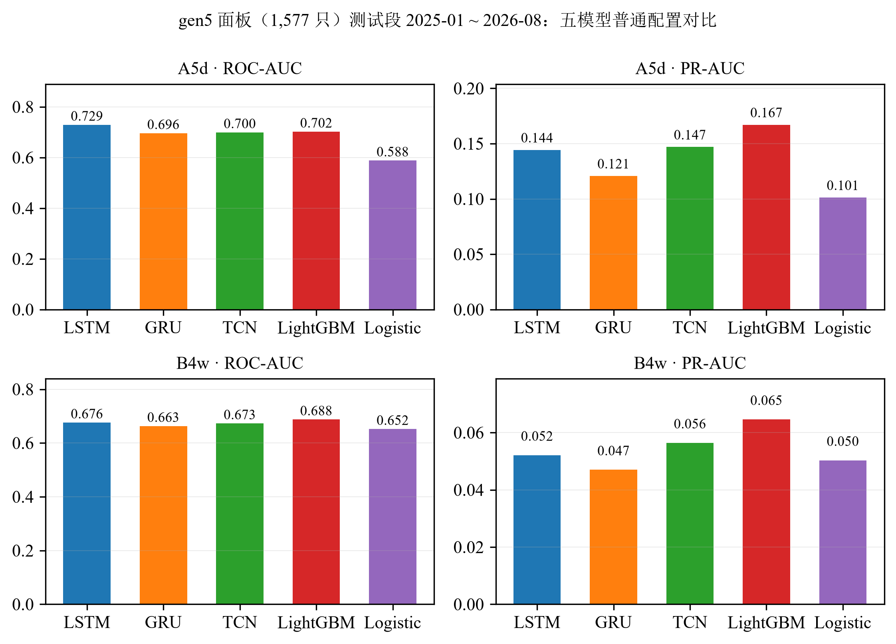
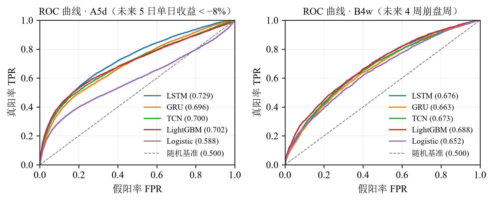
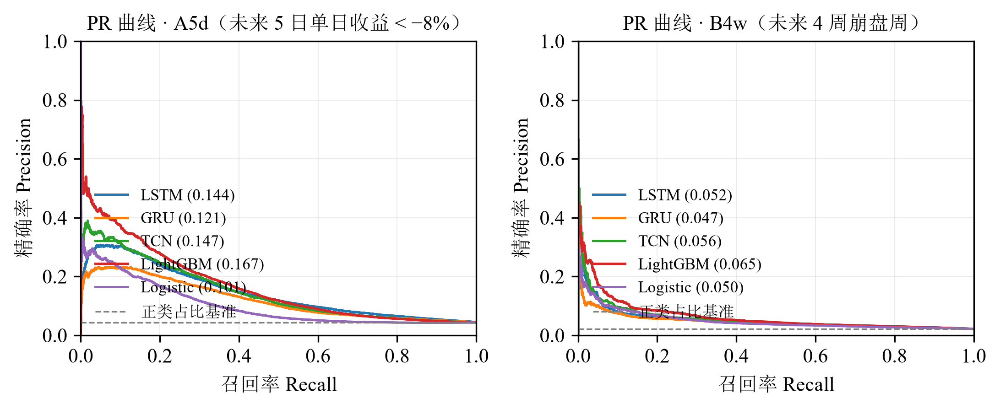
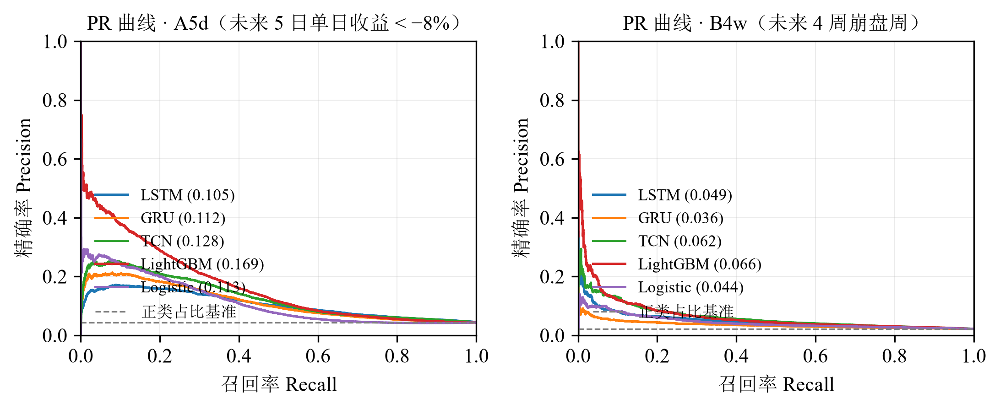
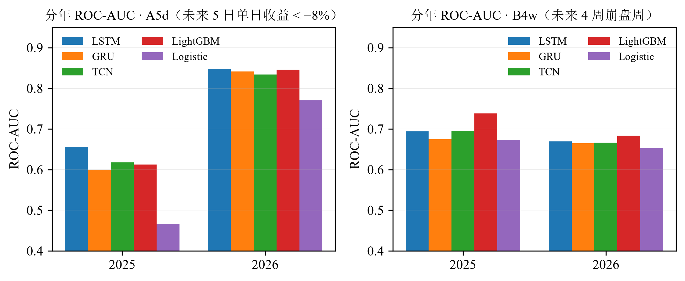
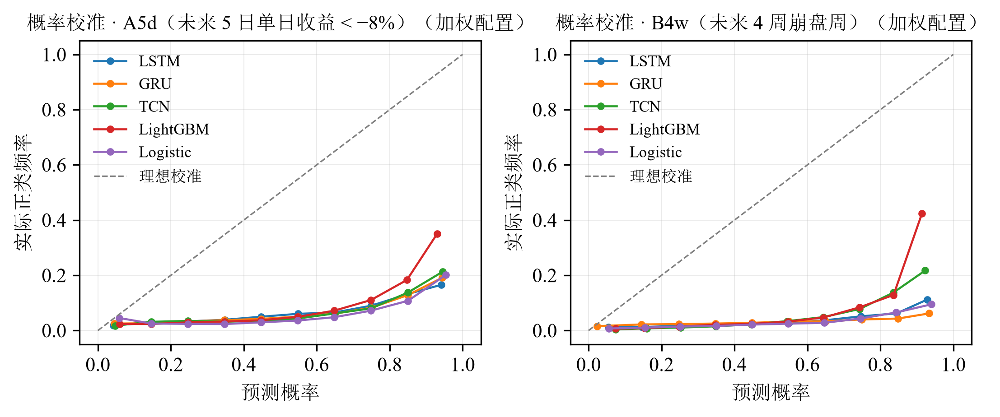
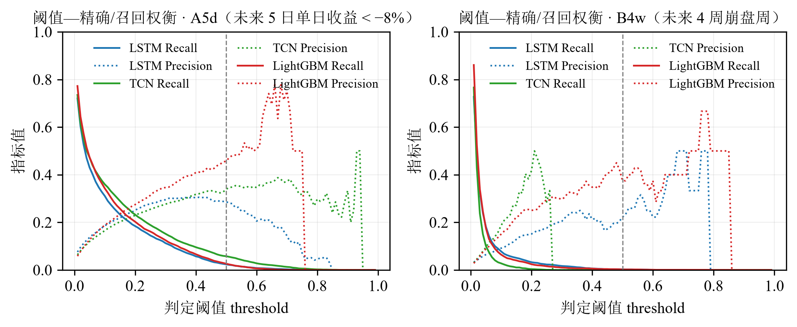
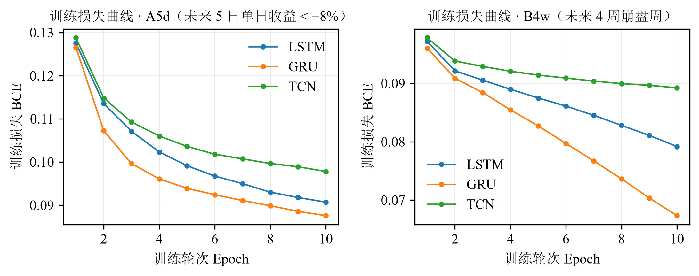
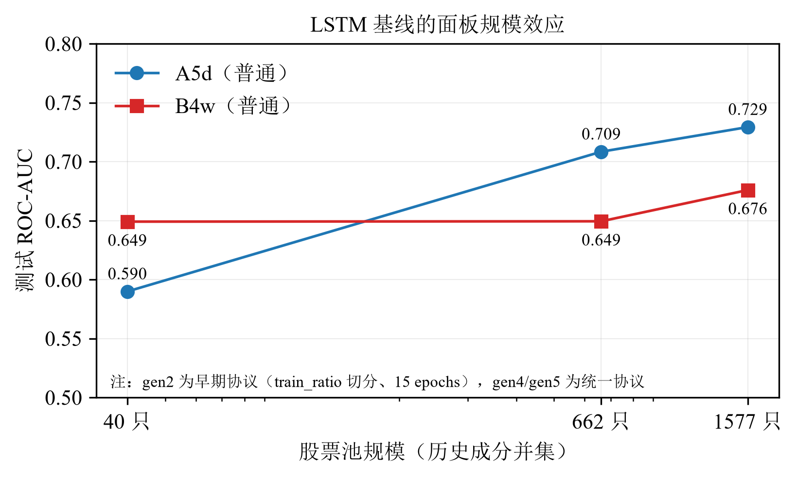

流程与模型结构：

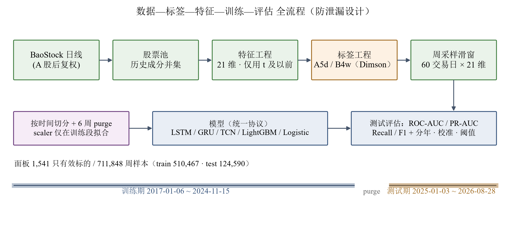
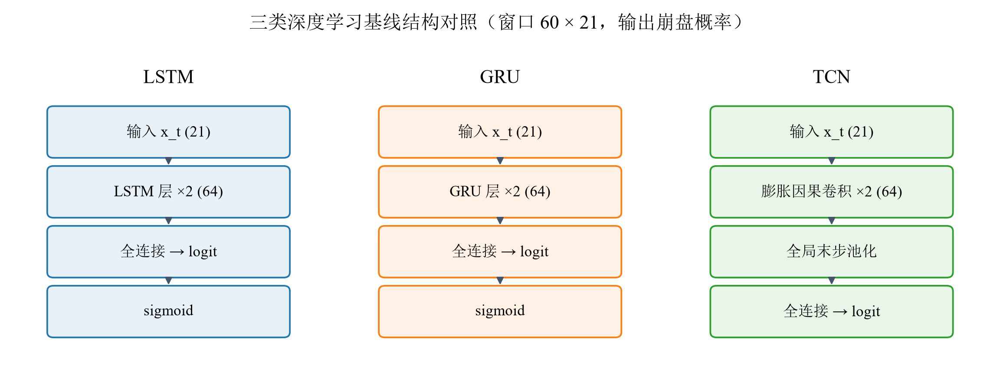

### 训练耗时（CPU，gen5 全量，10 epochs / batch 128）

| 模型 | 普通配置 | 加权配置 |
|---|---|---|
| LSTM | 无需重训：`--eval-only` 复算 ≈2 分钟 | 同 |
| GRU | ≈115 分钟 | ≈102 分钟 |
| TCN | ≈70 分钟 | ≈62 分钟 |
| LightGBM | ≈5 分钟 | ≈5.5 分钟 |
| 逻辑回归 | ≈3.5 分钟 | ≈5.5 分钟（峰值内存 ≈7.5 GB） |

### 结论的适用边界

- 测试段为单一时段（2025-01 ~ 2026-08）且单随机种子（42）：0.01–0.03 量级的 ROC 差异处于噪声范围，模型排名应理解为"该测试窗口内"；
- 各模型使用统一超参数预算、未逐模型调参；逻辑回归的 lbfgs 未完全收敛；
- Recall / F1 依赖判定阈值（此处 0.5），跨模型比较以 ROC-AUC / PR-AUC 为主；
- 无未来信息：特征仅用 t 及以前数据、标准化仅在训练段拟合、切分边界 purge 6 周、无测试集早停。

图表由 `python scripts\make_figures.py` 生成（PNG 300dpi + SVG 可编辑源，统一中文宋体 / 西文 Times New Roman 10.5 磅）。

## 与前期研究参考实现的差异

前期研究（课题前期四份调研材料）提供了任务框架与两类标签思想，本实现做了预测化改造与工程修正：

1. 崩盘周统计从"年度 ex-post"改为**滚动 52 周 trailing**（预测场景下口径因果化），并留 2 周 Dimson 干净期；
2. 单次随机/时间切分升级为**时间切分 + 边界 purge（默认 6 周）**；
3. 标准化 Scaler 与 winsorize 边界**仅在训练段拟合**；
4. 模型输出 logits 配合 `BCEWithLogitsLoss`（数值更稳定），并提供 `--pos-weight` 加权对照。

## 数据来源与免责声明

数据经 BaoStock 与 yfinance（Yahoo Finance）抓取，仅供学习与研究，不构成任何投资建议。BaoStock 数据为日线后复权价。

## 相关文档

- `docs/RESEARCH_DESIGN.md`：研究设计决策底稿（唯一设计来源）
- `AGENTS.md`：开发者与 Agent 的工作约定、命令与数据流
- `PROGRESS.md`：未完成事项与后续路线
